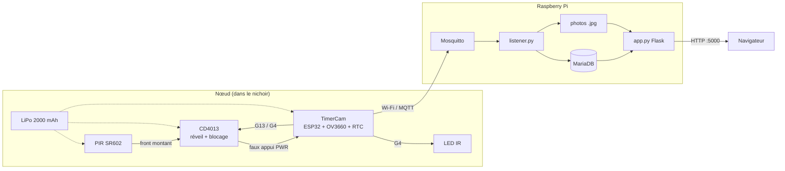

# PiouPiou : nichoir connecté

Projet SmartCities 2026-2027 (HEPL). Un nichoir qui photographie les oiseaux à chaque passage,
pour **moins de 50 €** et **6 mois d'autonomie** sur batterie.

Un capteur PIR rallume une caméra ESP32 **complètement éteinte** au repos. La photo, prise avec un éclairage
infrarouge, part en MQTT vers un Raspberry Pi qui la stocke dans MariaDB et l'affiche dans une galerie web.

## Architecture

## Fonctionnement

1. **Repos** : l'ESP32 est hors tension. Seuls la RTC, le PIR et le CD4013 consomment (≈ 23 µA).
2. **Un oiseau bouge** : le PIR fait basculer le CD4013, qui « appuie » électroniquement sur le bouton d'allumage.
3. **Photo** : l'ESP32 bloque le PIR, prend la photo avec la LED IR, l'envoie en MQTT avec le niveau de batterie.
4. **Délai de 5 min** : la carte se coupe ; le PIR reste bloqué par la 2ᵉ bascule, même si l'oiseau reste dans le nid.
5. **Réarmement** : la RTC rallume la carte un instant pour réactiver le PIR.
6. **Heartbeat** : une fois par jour, la RTC rallume la carte pour envoyer le niveau de batterie.

## Contenu du dépôt

| Dossier | Contenu |
|---|---|
| [`firmware/`](firmware/) | Code de la TimerCam (Arduino) |
| [`server/`](server/) | Raspberry Pi : listener MQTT, base MariaDB, galerie Flask |
| [`hardware/`](hardware/) | Schéma de câblage, nomenclature, principe du réveil |
| [`docs/`](docs/) | Tests sur breadboard, mesures, rapport |
| [`labs/pico/`](labs/pico/) | Labos du cours sur Raspberry Pi Pico |

## Messages MQTT

| Topic | Contenu |
|---|---|
| `nichoir/<id>/event` | `{"type":"pir","seq":42,"batt_mv":3920,"batt_pct":78,"rssi":-61,"photo":true}` |
| `nichoir/<id>/photo/<seq>` | JPEG binaire, même `seq` que l'événement |

`type` vaut `pir`, `heartbeat` ou `low_batt`.

## Démarrage rapide

1. **Serveur** : suivre [`server/README.md`](server/README.md) (Mosquitto, MariaDB, Flask).
2. **Firmware** : suivre [`firmware/README.md`](firmware/README.md), puis se connecter au Wi-Fi **Nichoir-Setup**
   pour choisir le réseau et l'adresse du Pi.
3. **Hardware** : câbler selon [`hardware/`](hardware/), batterie branchée, USB débranché.

## Avancement

- [x] Logique de réveil et de blocage du PIR validée sur breadboard ([détails](docs/tests_breadboard.md))
- [x] Firmware : séquences PIR / fin du délai / heartbeat
- [x] Serveur : listener, base de données, galerie
- [ ] Test du firmware sur la TimerCam (extinction, réveil RTC)
- [ ] Système complet sur batterie
- [ ] Mesures de consommation et bilan d'autonomie
- [ ] Breakout soudée et intégration dans le nichoir
- [ ] Rapport

## Équipe

- Oscar Agatone
