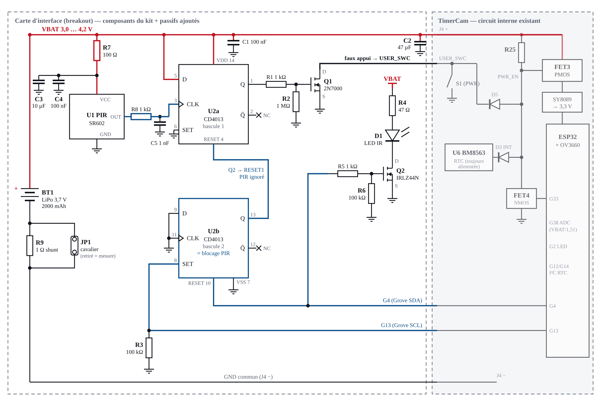

# Hardware

`schema_cablage.html` : version complète à ouvrir dans un navigateur (schéma, états des bascules,
séquences, liste des connexions, tests au banc, architecture globale).

## Principe du réveil

Au repos, l'ESP32 est **réellement hors tension** (FET3 bloqué). Restent alimentés : RTC BM8563, PIR et CD4013 (~23 µA).

1. Le PIR produit un front montant sur CLK1 : la bascule 1 passe à Q1 = 1.
2. Q1 commande le 2N7000, qui tire USER_SWC à la masse (« faux appui » sur le bouton PWR) : la carte s'allume.
3. L'ESP32 maintient son alimentation (G33 = 1), puis envoie une impulsion sur **G13 → SET2**.
   Q2 = 1 force RESET1 : le faux appui est relâché et **le PIR est bloqué**, même si l'oiseau bouge.
4. Photo, MQTT, puis compte à rebours RTC de 5 min et coupure (G33 = 0).
5. Fin du délai : la RTC rallume la carte, l'ESP32 envoie une impulsion sur **G4 → RESET2** : le PIR est réarmé.

## Nomenclature

| Réf. | Composant | Rôle |
|---|---|---|
| U1 | PIR SR602 | Détection (≈ 20 µA au repos, impulsion ≈ 2 s, redéclenchable) |
| U2 | CD4013 | Bascule 1 : mémorise le front du PIR. Bascule 2 : blocage du PIR pendant le délai |
| Q1 | 2N7000 (TO-92, S-G-D) | Faux appui sur le bouton PWR (~40 µA à commuter) |
| Q2 | IRLZ44N (TO-220, G-D-S, languette = drain) | LED IR, logic-level : conduit pleinement avec G4 à 3,3 V |
| D1 | LED IR | Éclairage pendant la photo |
| R1, R5 | 1 kΩ | Résistances de grille |
| R2 | 1 MΩ | Pull-down de la grille de Q1 |
| R3, R6 | 100 kΩ | Pull-down de G13 et G4 quand l'ESP32 est coupé (indispensables) |
| R4 | 47 Ω, 1/4 W | Courant de la LED IR (≈ 40 à 54 mA selon VBAT) |
| R7 + C3 | 100 Ω + 10 µF | Filtre de l'alimentation du PIR (évite les faux déclenchements pendant le Wi-Fi) |
| R8 + C5 | 1 kΩ + 1 nF | Filtre de l'horloge CLK1 (τ = 1 µs, < 15 µs max datasheet) |
| R9 + JP1 | 1 Ω + cavalier | Shunt de mesure du courant (cavalier en place en usage normal) |
| C1, C4 | 100 nF | Découplage du CD4013 et du PIR |
| C2 | 47 µF céramique | Réserve pour les pics de courant Wi-Fi (300–500 mA) |
| BT1 | LiPo 3,7 V 2000 mAh | Source d'énergie |

## Points d'attention

- **Ne jamais mettre G13 et G4 à 1 en même temps** : SET2 = RESET2 = 1 est un état interdit (Q = Q̄ = 1).
- Toutes les entrées CMOS inutilisées sont reliées à un niveau fixe (SET1, D2, CLK2).
- CD4013 : alimentation **3 V minimum** (datasheet TI) : le firmware ne prend plus de photo sous 3,3 V de batterie.
- Avec l'USB branché, la carte ne peut pas se couper : les tests d'extinction se font sur batterie.

## Datasheets

- [M5Stack TimerCam](https://docs.m5stack.com/en/unit/TimerCamera) ([schéma](https://m5stack-doc.oss-cn-shenzhen.aliyuncs.com/1042/Sch_M5TimerCAM.pdf))
- [CD4013B (Texas Instruments)](https://www.ti.com/lit/ds/symlink/cd4013b.pdf)
